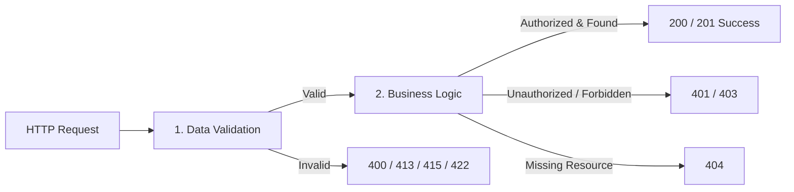

# 365 (Memory Bank) — Backend Business Rules & API Specifications

This document defines the architectural business rules, data validation constraints, business logic execution flows, and error handling behaviors across all REST API endpoints for the **365 (Memory Bank)** backend.

---

## 1. Global Architectural & Security Policies

### 1.1 Authentication & Cross-Tenant Data Isolation
- **Authentication Standard:** All protected endpoints require a standard HTTP Authorization header: `Authorization: Bearer <JWT_ACCESS_TOKEN>`.
- **Strict 401 Enforcement:** Any protected route invoked without an `Authorization` header, with an expired token, or with a malformed/tampered JWT **must strictly return `401 Unauthorized`**. Development fallback impersonation (`dev_user`) is strictly forbidden on protected production routes.
- **Cross-Tenant Isolation:** Users can **only** read, mutate, or delete records where `record.user_id == current_user.id`. Any attempt to access or modify another user's question, answer, or settings must return `404 Not Found` (or `403 Forbidden`).

### 1.2 Timezone & Calendar Day Integrity
- All persistent timestamps are stored in UTC with timezone awareness (`TIMESTAMP WITH TIME ZONE`).
- Daily progression (Day $1 \to 365$) is strictly bound to the user's registered local calendar date (`users.timezone`). Users cannot advance to Day $N+1$ until their local calendar day rolls over to tomorrow.

---

## 2. API Route Specifications

---

### Route Group 1: Authentication (`/api/auth`)

#### 1. `POST /api/auth/demo` — One-Click Demo Login
- **Auth:** Public
- **1. Data Validation:**
  - `email`: Valid RFC 5322 email string.
  - `name`: Non-empty string.
  - `timezone`: Optional string; if provided, must be a valid IANA timezone identifier (e.g. `'America/New_York'`). Defaults to `'UTC'`.
  - `interests`: Optional list of strings. If provided, must contain between 1 and 5 items from `AVAILABLE_INTERESTS`.
- **2. Business Logic:**
  - Look up user by `email`.
  - If user does not exist, create new `User` record with provided name, timezone, interests, and default `preferred_journaling_time = 20:00:00`.
  - If user exists, update timezone and interests if newly provided.
  - Issue signed JWT access token with 30-day expiration (`sub = user_id`, `email = user_email`).
- **3. Error Handling:**
  - `422 Unprocessable Entity`: Invalid email format, $>5$ interests, or unrecognized interest category.

#### 2. `POST /api/auth/google` — Google OAuth Token Exchange
- **Auth:** Public
- **1. Data Validation:**
  - `credential`: Non-empty Google OAuth ID token string.
- **2. Business Logic:**
  - Verify ID token against Google OAuth certs using `google-auth` with configured `GOOGLE_CLIENT_ID`.
  - Extract `sub` (Google ID), `email`, `name`, `picture`.
  - Look up user by `email`. If not found, provision new `User` record.
  - Issue signed JWT access token.
- **3. Error Handling:**
  - `400 Bad Request`: Token verification fails (expired, wrong audience, invalid signature).
  - `422 Unprocessable Entity`: Missing `credential` body parameter.

#### 3. `GET /api/auth/me` — Authenticated User Identity
- **Auth:** Protected (`Bearer <JWT>`)
- **1. Data Validation:**
  - Valid `Authorization: Bearer <token>` header.
- **2. Business Logic:**
  - Decode and verify JWT signature and expiration.
  - Query `users` by primary key `id = token.sub`.
  - Return user profile including `timezone`, `preferred_journaling_time`, `interests`, `streak_count`, and `max_streak`.
- **3. Error Handling:**
  - `401 Unauthorized`: Missing `Authorization` header, invalid signature, or expired token.
  - `404 Not Found`: User ID in token no longer exists in database.

---

### Route Group 2: Questions (`/api/questions`)

#### 4. `GET /api/questions/today` — Today's Daily Reflection Prompt
- **Auth:** Protected (`Bearer <JWT>`)
- **1. Data Validation:**
  - Valid `Authorization: Bearer <token>` header.
- **2. Business Logic:**
  - Retrieve user's latest question ordered by `day_number DESC` with eager-loaded `answer`.
  - Calculate user's current local date (`user_today`) using `user.timezone`.
  - **State A (New User - Day 1):** If no question exists, determine active interest group (`user.interests[0]`), check daily cache `daily_q:{interest}:{user_today}`. If cache miss, generate prompt via Claude / fallback bank and store in cache until midnight. Persist Day 1 `Question` for user.
  - **State B (Already Answered Today):** If last question is answered and `answer.created_at` in user's timezone has date $\ge user\_today$, user has already completed today's reflection. **Do not advance day.** Return last question with attached answer.
  - **State C (Next Day Eligible):** If last question is answered and $last\_ans\_date < user\_today$ and $day\_number < 365$, advance to Day $N+1$. Determine active interest group for Day $N+1$, check daily cache, persist Question for user, and return.
  - **State D (Milestone 365 Complete):** If $day\_number = 365$ and answered, return Day 365 in completion state.
- **3. Error Handling:**
  - `401 Unauthorized`: Missing/invalid token.

#### 5. `GET /api/questions/{day_number}` — Historical Question Lookup
- **Auth:** Protected (`Bearer <JWT>`)
- **1. Data Validation:**
  - Path parameter `day_number`: Integer between 1 and 365.
- **2. Business Logic:**
  - Query `questions` where `user_id == current_user.id AND day_number == day_number`.
  - Eager-load attached `answer`.
- **3. Error Handling:**
  - `400 Bad Request`: `day_number < 1` or `day_number > 365`.
  - `401 Unauthorized`: Missing/invalid token.
  - `404 Not Found`: Question for this day has not yet been generated for this user.

---

### Route Group 3: Answers & Media (`/api/answers`, `/api/media`)

#### 6. `POST /api/answers` — Submit / Upsert Reflection Answer
- **Auth:** Protected (`Bearer <JWT>`)
- **1. Data Validation:**
  - `question_id`: Integer $> 0$.
  - At least one content field (`text`, `photo_url`, `audio_url`) must be non-empty.
- **2. Business Logic:**
  - Verify question exists and belongs to user (`Question.id == question_id AND Question.user_id == current_user.id`).
  - Check if answer exists (`Answer.question_id == question_id`).
  - **If Exists (Update):** Overwrite provided fields, update `user.last_answered_at = utc_now()`.
  - **If New (Insert):** Insert `Answer`. Update user streaks:
    - If `user.last_answered_at` was yesterday in user local timezone: `streak_count += 1`.
    - If user has no streak: `streak_count = 1`.
    - Update `max_streak = max(max_streak, streak_count)`.
    - Set `user.last_answered_at = utc_now()`.
- **3. Error Handling:**
  - `401 Unauthorized`: Missing/invalid token.
  - `404 Not Found`: Question does not exist or belongs to another user.
  - `422 Unprocessable Entity`: Neither text, photo, nor audio was provided.

#### 7. `GET /api/answers/{id}` — Retrieve Specific Memory
- **Auth:** Protected (`Bearer <JWT>`)
- **1. Data Validation:**
  - Path parameter `id`: Integer $> 0$.
- **2. Business Logic:**
  - Query `Answer` by primary key `id`.
  - Check ownership: verify `Answer.user_id == current_user.id`.
- **3. Error Handling:**
  - `401 Unauthorized`: Missing/invalid token.
  - `404 Not Found`: Answer not found or belongs to another user.

#### 8. `PUT /api/answers/{id}` — Update Existing Memory
- **Auth:** Protected (`Bearer <JWT>`)
- **1. Data Validation:**
  - Path parameter `id`: Integer $> 0$.
  - Body: `AnswerUpdate` (`text`, `photo_url`, `audio_url`).
- **2. Business Logic:**
  - Verify answer exists and `Answer.user_id == current_user.id`.
  - Update non-null fields provided in payload.
  - Commit and return updated answer.
- **3. Error Handling:**
  - `401 Unauthorized`: Missing/invalid token.
  - `404 Not Found`: Answer not found or belongs to another user.

#### 9. `DELETE /api/answers/{id}` — Delete Memory
- **Auth:** Protected (`Bearer <JWT>`)
- **1. Data Validation:**
  - Path parameter `id`: Integer $> 0$.
- **2. Business Logic:**
  - Verify answer exists and `Answer.user_id == current_user.id`.
  - Delete answer record. (Associated `Question` remains in timeline as unanswered).
  - Recalculate user memory stats.
- **3. Error Handling:**
  - `401 Unauthorized`: Missing/invalid token.
  - `404 Not Found`: Answer not found or belongs to another user.

#### 10. `POST /api/answers/upload-photo` — Photo Upload
- **Auth:** Protected (`Bearer <JWT>`)
- **1. Data Validation:**
  - File parameter `file`: Multipart file upload.
  - Size check: Length $\le 10\text{ MB}$ (10,485,760 bytes).
  - MIME type check: Must be in `['image/jpeg', 'image/png', 'image/webp', 'image/heic']`.
- **2. Business Logic:**
  - Stream file bytes, upload to S3 bucket or local dev directory. Return accessible URL.
- **3. Error Handling:**
  - `401 Unauthorized`: Missing/invalid token.
  - `413 Payload Too Large`: File exceeds 10MB limit.
  - `415 Unsupported Media Type`: Non-image file or invalid image MIME type.

#### 11. `POST /api/answers/upload-voice` — Voice Note Upload
- **Auth:** Protected (`Bearer <JWT>`)
- **1. Data Validation:**
  - File parameter `file`: Multipart file upload.
  - Size check: Length $\le 25\text{ MB}$ (26,214,400 bytes).
  - MIME type check: Must be in `['audio/webm', 'audio/mp4', 'audio/mpeg', 'audio/ogg', 'audio/wav', 'audio/x-m4a']`.
- **2. Business Logic:**
  - Upload audio to S3 bucket or local dev directory. Return accessible URL.
- **3. Error Handling:**
  - `401 Unauthorized`: Missing/invalid token.
  - `413 Payload Too Large`: Audio exceeds 25MB limit.
  - `415 Unsupported Media Type`: Non-audio file.

#### 12. `POST /api/media/presign-upload` — Pre-signed S3 Direct Upload
- **Auth:** Protected (`Bearer <JWT>`)
- **1. Data Validation:**
  - `filename`: Non-empty filename string.
  - `content_type`: Valid image or audio MIME type.
  - `media_type`: Enum string `'photo'` or `'voice'`.
- **2. Business Logic:**
  - Validate file type against size limits (10MB for photo, 25MB for voice).
  - Generate S3 pre-signed `PUT` URL and public access URL.
  - Client uploads directly to S3, bypassing FastAPI server memory.
- **3. Error Handling:**
  - `401 Unauthorized`: Missing/invalid token.
  - `415 Unsupported Media Type`: Unsupported content type.

---

### Route Group 4: Timeline (`/api/timeline`)

#### 13. `GET /api/timeline` — Paginated & Filtered Journal Feed
- **Auth:** Protected (`Bearer <JWT>`)
- **1. Data Validation:**
  - `page`: Integer $\ge 1$ (default: 1).
  - `limit`: Integer between 1 and 100 (default: 20).
  - `format`: Optional enum (`'all'`, `'text'`, `'photo'`, `'audio'`).
  - `theme`: Optional string tag.
  - `search`: Optional string search query.
- **2. Business Logic:**
  - Query `questions` joined with `answers` where `questions.user_id == current_user.id`.
  - Apply filters:
    - If `format == 'photo'`: filter `Answer.photo_url.isnot(None)`.
    - If `format == 'audio'`: filter `Answer.audio_url.isnot(None)`.
    - If `format == 'text'`: filter `Answer.text.isnot(None) AND Answer.text != ''`.
    - If `theme`: filter `Question.theme_tags.ilike(f"%{theme}%")`.
    - If `search`: full-text tsvector match `to_tsvector('english', COALESCE(text, '')) @@ plainto_tsquery(...)` or ILIKE fallback.
  - Order by `Question.day_number ASC`.
  - Calculate `total_items`, `total_pages = ceil(total_items / limit)`, `has_next`, `has_prev`.
  - Slice items via `offset((page - 1) * limit).limit(limit)`.
- **3. Error Handling:**
  - `400 Bad Request`: `page < 1` or `limit < 1` or `limit > 100`.
  - `401 Unauthorized`: Missing/invalid token.

---

### Route Group 5: User Settings & Export (`/api/users`)

#### 14. `PUT /api/users/preferences` — Update User Preferences
- **Auth:** Protected (`Bearer <JWT>`)
- **1. Data Validation:**
  - `timezone`: Optional string; if provided, must be valid IANA timezone identifier.
  - `preferred_journaling_time`: Optional time or string (`HH:MM` or `HH:MM:SS`).
  - `notification_time_preference`: Optional string `HH:MM`.
  - `interests`: Optional list of strings; must contain between 1 and 5 items from `AVAILABLE_INTERESTS`.
  - `push_token`: Optional string token.
- **2. Business Logic:**
  - Synchronize `preferred_journaling_time` and `notification_time_preference`.
  - Update user attributes in database, commit and refresh.
- **3. Error Handling:**
  - `400 Bad Request`: Invalid timezone string.
  - `401 Unauthorized`: Missing/invalid token.
  - `422 Unprocessable Entity`: $>5$ interests or invalid interest category.

#### 15. `GET /api/users/export` — Full Memory Bank Archive
- **Auth:** Protected (`Bearer <JWT>`)
- **1. Data Validation:**
  - Valid `Authorization: Bearer <token>` header.
- **2. Business Logic:**
  - Retrieve user profile details.
  - Query all questions and answers belonging to user ordered by `day_number ASC`.
  - Bundle into a structured JSON archive containing user metadata, streak records, completion stats, and all daily memories with media links.
- **3. Error Handling:**
  - `401 Unauthorized`: Missing/invalid token.
