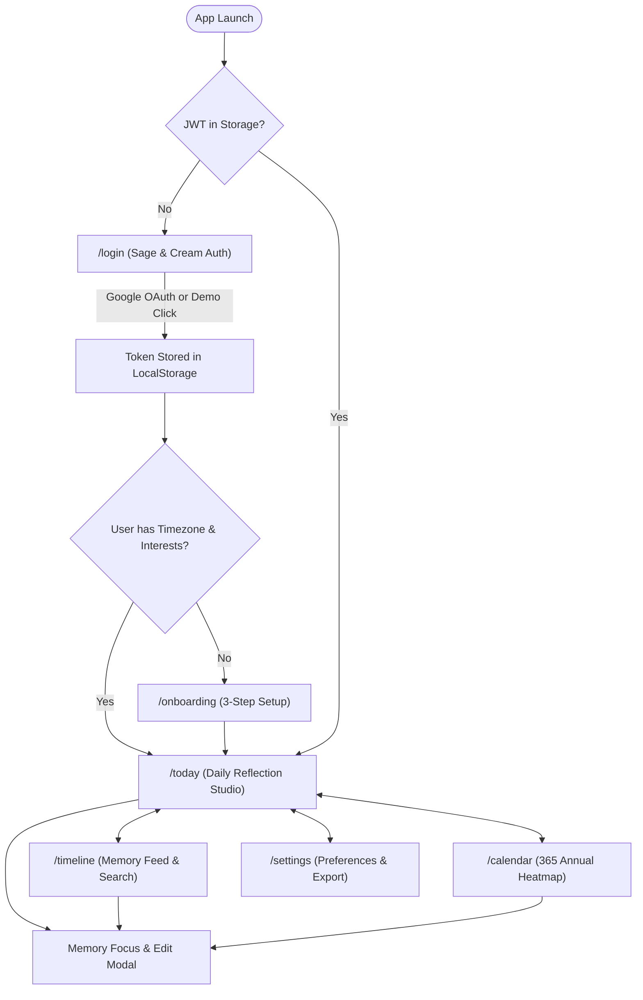

# 365 (Memory Bank) — Frontend Design Document (Sage & Cream Vintage Theme)

## 1. Executive Design Philosophy & Aesthetic Transformation

This design specification adapts the entire frontend of **365 (Memory Bank)** to the **"Sage & Cream" Vintage Calligraphic Aesthetic** established in the provided authentication page template.

### The Shift from Dark Neon to Vintage Calligraphic
- **Previous Aesthetic:** Dark obsidian (`#07090e`), neon indigo/purple (`#6366f1`/`#8b5cf6`), modern sans-serif (`Outfit`/`Plus Jakarta Sans`), glassmorphism panels, emoji badges.
- **New Aesthetic (Sage & Cream):**
  - **Atmosphere:** An intimate, tactile, warm-linen journal or archival book of memories.
  - **Canvas Surface:** Warm cream paper canvas (`#f6f4ee`) with delicate radial ambient glows of botanical sage (`rgba(92,138,92,0.14)`) and warm ochre/amber (`rgba(184,129,47,0.12)`).
  - **Cards & Enclosures:** Pressed warm ivory paper (`#fffdf8`) with delicate sand borders (`#d8d0bc`, `#e5ded0`), rounded corners (`16px–24px`), and soft organic ambient shadows (`0 24px 60px -24px rgba(42,45,37,0.18)`).
  - **Typography (Google Fonts):**
    - **Display & Question Prompts:** *Instrument Serif* (400 italic & regular) — an expressive, calligraphic editorial serif giving each daily question the weight of timeless literature.
    - **Display Accents & Badges:** *Playfair Display* (500/600/700) — vintage luxury serif for badges and section markers.
    - **Long-form Reading & Reflections:** *Lora* (400/500 italic & regular) — bookish, warm literary serif designed for thoughtful introspection.
    - **Controls, Meta & Timers:** *Inter* (400/500/600) — neutral, hyper-legible sans-serif for timestamps, counters, inputs, and buttons.
  - **Iconography Rule:**
    - **Strict prohibition of emojis.** All emojis (`☀️`, `📖`, `📅`, `⚙️`, `🔥`, `📝`, `🎙️`, `📷`, etc.) are replaced with bespoke, crisp SVG/Lucide React icons (`Sun`, `BookOpen`, `Calendar`, `Settings`, `Flame`, `FileText`, `Mic`, `Camera`, `Sparkles`, `Clock`, `Share2`, `Trash2`, `Edit3`, `SlidersHorizontal`, etc.).

---

## 2. Design System Tokens & Palette

### 2.1 Color Tokens
```css
:root {
  /* Canvas & Paper Backgrounds */
  --bg-canvas: #f6f4ee;           /* Warm linen paper canvas */
  --bg-card: #fffdf8;             /* Warm ivory/cream card surface */
  --bg-card-subtle: #f9f7f1;      /* Secondary container / input background */
  --bg-card-hover: #f3efe6;       /* Interactive hover background */
  --bg-badge: #d9d3c5;            /* Warm sand badge pill fill */

  /* Borders & Dividers */
  --border-card: #d8d0bc;         /* Pressed paper edge border */
  --border-light: #e8e2d4;        /* Soft divider border */
  --border-focus: #6e7262;        /* Focused input border */

  /* Typography */
  --text-primary: #2a2d25;        /* Deep charcoal olive (main text) */
  --text-serif-heading: #6e7262;  /* Sage olive for questions & headings */
  --text-muted: #6e7262;          /* Secondary descriptive text */
  --text-dim: #9b988c;            /* Micro-copy & subtle labels */
  --text-sand: #b8b09a;           /* Dividers and uppercase or-tags */

  /* Primary Action Buttons & Accents */
  --btn-primary-bg: #757267;      /* Warm weathered charcoal / deep sage */
  --btn-primary-hover: #5f5c53;   /* Darker hover state */
  --btn-primary-text: #fff3d5;    /* Pale cream button text */
  --btn-secondary-bg: #ffffff;    /* Clean white button */
  --btn-secondary-border: #d8d0bc;/* Sand border */
  --btn-secondary-text: #2a2d25;  /* Deep text */

  /* Functional Accents */
  --accent-sage: #5c8a5c;         /* Voice note & completed text accent */
  --accent-amber: #b8812f;        /* Photo attachment & habit flame */
  --accent-terracotta: #c25e5e;   /* Errors, warning & delete triggers */
  --accent-indigo: #576574;       /* Deep slate accent */

  /* Shadows & Radius */
  --shadow-card: 0 24px 60px -24px rgba(42, 45, 37, 0.18);
  --shadow-subtle: 0 4px 16px -4px rgba(42, 45, 37, 0.08);
  --shadow-dropdown: 0 12px 36px -8px rgba(42, 45, 37, 0.16);
  --radius-sm: 8px;
  --radius-md: 14px;
  --radius-lg: 20px;
  --radius-xl: 24px;
  --radius-full: 9999px;
}
```

### 2.2 Typography Scale & Pairing

| Role | Font Family | Weight & Style | Size / Line Height | Usage |
|---|---|---|---|---|
| **Daily Prompt & Hero Title** | `'Instrument Serif', Georgia, serif` | `400 Italic` | `32px–40px / 1.25` | Main daily question, hero headlines on auth & celebration. |
| **Section & Card Titles** | `'Instrument Serif', Georgia, serif` | `400 Regular` | `24px–28px / 1.3` | Modal titles, timeline question headers, year metrics headers. |
| **Brand Wordmark & Badges**| `'Playfair Display', serif` | `600 Regular` | `12px–14px / 1.4` (caps) | Badge pills (`MEMORY BANK`), theme tags, Day tags. |
| **Reflection Reading Body** | `'Lora', Georgia, serif` | `400 / 500 Regular` | `16px–18px / 1.7` | Saved memory answer text, long-form thoughts, markdown viewer. |
| **UI Controls & Navigation**| `'Inter', sans-serif` | `500 / 600 SemiBold` | `14px–15px / 1.4` | Buttons, navigation links, tabs, form inputs. |
| **Micro-data & Countdown** | `'Inter', monospace` | `500 Regular` | `12px–13px / 1.4` | Timer countdown, word counters, timestamps, streak counts. |

---

## 3. End-to-End User Flow & Navigation Architecture

The application operates as an authenticated Single Page Application with five primary views, a 3-step setup wizard, and contextual modals:



---

## 4. Component-by-Component Specifications

### 4.1 Navigation Shell (`Header.jsx` & `BottomNav.jsx`)
- **Theme:** Minimalist, warm paper container with `#d8d0bc` bottom border.
- **Elements:**
  - **Brand Badge:** Oval pill badge (`#d9d3c5`) with *Playfair Display* label `"MEMORY BANK"` and vintage *Instrument Serif* `"365"`.
  - **Navigation Tabs:** Clean segmented toggle with vintage border (`#d8d0bc`).
    - Tab 1: `<Sun size={15} /> Today`
    - Tab 2: `<BookOpen size={15} /> Timeline`
    - Tab 3: `<Calendar size={15} /> 365 Grid`
  - **Day & Streak Indicator:**
    - Streak badge with `<Flame size={15} color="#b8812f" />` and warm amber count.
    - Circular day progress: `"Day 18 of 365"`.
  - **Settings Action:** Circular button triggering Settings view with `<Settings size={17} />`.
  - **Mobile Bottom Bar:** Fixed on mobile devices with haptic visual taps and icon-driven tabs.

---

### 4.2 Authentication View (`AuthView.jsx`)
- **Visuals:** Faithful React implementation of the provided HTML template.
- **Layout:** Centered `480px` card on `#f6f4ee` canvas with ambient sage and ochre background radial gradients.
- **Card Elements:**
  - Memory Bank brand pill badge (`#d9d3c5`).
  - *Instrument Serif* italic title: *"One question a day. 365 days."*
  - Subtitle in *Playfair Display*: *"An AI-curated bank of who you were — in text, voice, or a photo, whenever you have a moment."*
  - **Google OAuth Button:** White button with Google SVG logo.
  - **Divider:** Sand line with uppercase `"or"`.
  - **Demo Button:** Warm charcoal button (`#757267`) with cream text (`#FFF3D5`): *"Explore with demo account"*.
  - Feature highlights strip with Lucide icons (Voice, Heatmap, Export).

---

### 4.3 Onboarding Wizard (`OnboardingWizard.jsx`)
- **Step 1: Rhythm & Schedule:**
  - Timezone selector with browser auto-detection.
  - Native time picker for preferred daily reflection delivery.
  - Clean preview: *"Your daily reflection will arrive at 8:00 PM (America/New_York)."*
- **Step 2: Core Interests (1 to 5):**
  - Interactive grid for the 10 curated themes: `philosophy`, `career`, `relationships`, `mindfulness`, `creativity`, `growth`, `gratitude`, `childhood`, `daily_life`, `future`.
  - Sage/sand pill styling with counter (`"Selected: 3 of 5"`).
- **Step 3: Gentle Reminders:**
  - Web Push explanation card with `<Bell size={24} />` icon.
  - "Enable Reminders" and "Skip for Now" buttons.

---

### 4.4 Daily Reflection Studio (`DailyQuestion.jsx` / `/today`)
- **Unanswered State:**
  - **Prompt Hero Card:**
    - Day progress indicator (`"DAY 18 / 365"`).
    - Theme tags pill badges (`#philosophy`, `#mindfulness`).
    - Question prompt rendered in *Instrument Serif* italic (`font-size: 30px–36px`, color `#2a2d25`).
  - **Multi-Modal Composer:**
    - **Markdown Text Reflection:** Warm cream textarea with auto-grow, character counter, word counter, and `"Draft saved"` autosave indicator.
    - **Voice Note Studio:**
      - Record button with `<Mic size={18} />`.
      - Live HTML5 Canvas audio waveform visualizer (animated sage bars).
      - Timer display (`"01:24 / 05:00"`).
      - Interactive playback scrubber with play/pause and delete button.
    - **Photo Attachment:**
      - Drag-and-drop zone with `<Camera size={20} />` icon.
      - Thumbnail preview with aspect ratio preservation and remove trigger.
    - **Save Memory Button:** Primary button (`#757267`) with `<Send size={16} />` icon. Shortcuts: `Cmd + Enter`.
- **Answered Memory State:**
  - Card showcasing today's submitted reflection.
  - Audio waveform player with seeking and duration.
  - Photo viewer with lightbox click.
  - Inline Edit button (`<Edit3 size={16} />`).
  - **Tomorrow's Countdown Clock:**
    - Real-time ticking timer to midnight in the user's timezone: *"Your next reflection arrives in 4h 18m."*
- **Celebration Modal:**
  - Canvas confetti burst with streak count milestone celebration ("14 Day Streak Reached!").

---

### 4.5 Chronological Archive (`Timeline.jsx` / `/timeline`)
- **Header Filters & Search:**
  - Format toggle pill group with Lucide icons (NO emojis!):
    - `<FileText size={14} /> Text`
    - `<Mic size={14} /> Voice`
    - `<Camera size={14} /> Photos`
  - Theme tags filter chip carousel.
  - Debounced instant search input with `<Search size={16} />`.
- **Throwback Flashback Card:**
  - Surfaces a memory written on this day in past months/years with vintage stamp badge.
- **Memory Card Feed:**
  - Elegant card with day number, date, prompt question in serif, reflection in *Lora*, inline voice player, photo preview, and edit/delete actions.

---

### 4.6 365 Annual Heatmap Grid (`CalendarGrid.jsx` / `/calendar`)
- **Year Summary Metrics:**
  - Total Memories Saved, Current Streak (`<Flame />`), Days Remaining, Longest Streak.
- **365-Day Contribution Grid:**
  - 365 cells mapped into a responsive matrix (52 weeks / 12 months).
  - **Vintage Color Legend:**
    - Completed Text: Sage Green (`#5c8a5c`)
    - Completed Photo: Warm Amber / Ochre (`#b8812f`)
    - Completed Voice: Deep Slate Olive (`#6e7262`)
    - Completed Multi-modal: Terracotta / Rose (`#c25e5e`)
    - Today (Unanswered): Pulsing warm amber border with dot
    - Missed/Skipped: Subtle hatched border
    - Future: Translucent muted placeholder
  - Interactive tooltip displaying date, prompt excerpt, and media badges on hover/tap.
  - Click on day navigates directly to memory focus view or `/today`.

---

### 4.7 Memory Focus & Mutation Modal (`MemoryDetailModal.jsx`)
- Full-screen or centered modal for inspecting a single reflection.
- Audio playback speed toggle ($1\times, 1.25\times, 1.5\times, 2\times$).
- High-resolution photo zoom lightbox.
- Inline Markdown editor with Save/Cancel.
- Delete confirmation dialog with safety confirmation.
- Export as shareable memory card graphic.

---

### 4.8 Settings & Data Sovereignty (`SettingsModal.jsx` / `/settings`)
- User Profile card with avatar, name, email, and member since date.
- Timezone selector and Daily Delivery Time input.
- Web Push notification toggle with browser permission check.
- Curated Interests selector (1 to 5 categories).
- **Data Sovereignty:** One-click "Download Complete Archive" button (downloads structured JSON bundle).
- Session Sign Out and Demo Reset.

---

## 5. Implementation Roadmap & Execution Order

1. **Step 1:** Update `client/index.html` to load Google Fonts (*Instrument Serif*, *Playfair Display*, *Lora*, *Inter*).
2. **Step 2:** Refactor `client/src/index.css` to define the complete Sage & Cream design tokens, vintage cards, buttons, badges, and layout utilities.
3. **Step 3:** Extend `client/src/api.js` to support all backend endpoints (pagination, search, delete, update, export, me, preferences).
4. **Step 4:** Build `AuthView.jsx` matching the HTML auth page.
5. **Step 5:** Build `OnboardingWizard.jsx` for the 3-step personalization setup.
6. **Step 6:** Overhaul `Header.jsx` with the vintage Sage & Cream styling and Lucide icons.
7. **Step 7:** Overhaul `DailyQuestion.jsx` with the vintage prompt card, canvas waveform studio, photo dropzone, and countdown timer.
8. **Step 8:** Rebuild `Timeline.jsx` with icon-based format filters, theme pills, search, and flashback cards.
9. **Step 9:** Implement `CalendarGrid.jsx` with the full 365-day annual heatmap matrix and tooltips.
10. **Step 10:** Implement `MemoryDetailModal.jsx` for focused inspection and editing.
11. **Step 11:** Upgrade `SettingsModal.jsx` with timezone, interests manager, web push, and JSON archive export.
12. **Step 12:** Connect all views smoothly in `App.jsx`, build and test end-to-end.
