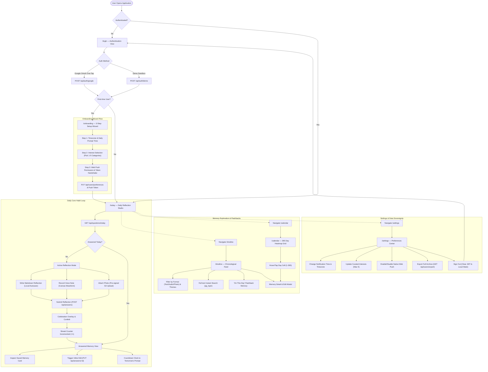
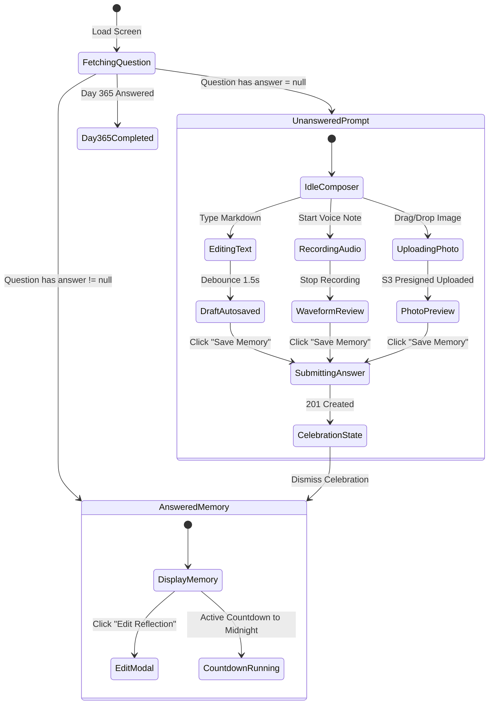
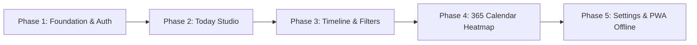

# 365 (Memory Bank) — Frontend Pages, User Flow & Component Architecture

This document defines the complete client-side architecture for the **365 (Memory Bank)** application. It details the end-to-end user flow, comprehensive page-by-page specifications, state machines, component hierarchies, design system tokens, and API integrations.

---

## 1. Product Vision & Design Philosophy

**365** transforms daily journaling from an intimidating blank page into a frictionless, reflective ritual:
- **One Question Per Day:** A single, evocative AI-generated question tailored to the user's selected interests.
- **Multi-Modal Reflection:** Lowers activation energy by allowing users to respond with **Markdown text**, **live audio voice notes**, or **photographs**.
- **The Obsidian Aesthetic:** A distraction-free, elegant dark aesthetic (obsidian `#0d0f12`, deep slate `#161920`, warm amber `#f59e0b`, and electric indigo `#6366f1`) with typography blending modern sans-serif (*Inter*) and editorial serif (*Instrument Serif*).
- **Zero Friction Habit:** Automatic draft autosaving, local timezone scheduling, PWA offline capability, and celebration milestones for daily consistency.

---

## 2. End-to-End User Flow

The state diagram below illustrates the complete user lifecycle from first arrival to daily journaling, reflection archive exploration, settings configuration, and session management.



---

## 3. Master Route & Page Directory

| URL Route | Page Name | Access Level | Layout Shell | Primary Objective & Purpose |
|---|---|---|---|---|
| `/login` | **Authentication & Welcome** | Public | `AuthLayout` | Google OAuth one-tap sign-in, instant demo sandbox login, and product introduction. |
| `/onboarding` | **Habit Setup Wizard** | Protected (First-run guard) | `OnboardingLayout` | 3-step personalization: detect timezone, configure notification hour, pick 1–5 interest tags. |
| `/today` | **Daily Reflection Studio** | Protected | `AppLayout` | **Core Hero Screen:** Read daily prompt, compose reflection (text/audio/photo), celebrate completion. |
| `/timeline` | **Chronological Archive** | Protected | `AppLayout` | Searchable, paginated timeline feed of past memories with format filters and throwbacks. |
| `/calendar` | **365 Annual Heatmap** | Protected | `AppLayout` | Visual 365-day contribution matrix displaying completed, skipped, current, and upcoming days. |
| `/memory/:id` | **Memory Focus View** | Protected | `ModalOverlay` / `AppLayout` | Dedicated inspection, rich media playback, inline editing, and deletion for a single memory. |
| `/settings` | **Preferences & Sovereignty**| Protected | `AppLayout` | Timezone selection, daily delivery schedule, interest toggles, Web Push setup, JSON archive export. |

---

## 4. Deep-Dive Page Specifications & Component Breakdown

### 4.1 `/login` — Authentication & Welcome Screen

#### Purpose & UX
The gateway to the application. It establishes the obsidian, introspective aesthetic with fluid typography. New and returning users can authenticate instantly via Google OAuth or launch a sandboxed demo session with zero credentials.

#### Visual Hierarchy
```
┌─────────────────────────────────────────────────────────────┐
│ [Brand Badge: "365 — Your Life in Daily Reflections"]      │
│                                                             │
│         "One question a day. 365 days.                      │
│          An AI-curated bank of who you were."               │
│                                                             │
│   ┌─────────────────────────────────────────────────────┐   │
│   │ [ Google "Continue with Google" One-Tap Button ]    │   │
│   └─────────────────────────────────────────────────────┘   │
│                             - or -                          │
│   ┌─────────────────────────────────────────────────────┐   │
│   │ [ Quick Demo Sandbox: "Explore with Demo Account" ] │   │
│   └─────────────────────────────────────────────────────┘   │
│                                                             │
│ [Live Feature Showcase: Audio Waveforms • Calendar Heatmap] │
│ [Privacy Guarantee: Self-hosted • Zero tracking • Exportable]│
└─────────────────────────────────────────────────────────────┘
```

#### Component Inventory
1. **`AuthLayout`** (`src/layouts/AuthLayout.jsx`)
   - Centered responsive container with ambient gradient mesh background (`#0d0f12` with subtle amber/indigo radial glows).
2. **`BrandHeroHeader`** (`src/components/auth/BrandHeroHeader.jsx`)
   - Renders animated "365" wordmark with serif subtitle and habit promise statement.
3. **`GoogleOAuthButton`** (`src/components/auth/GoogleOAuthButton.jsx`)
   - Wraps Google Identity Services SDK (`window.google.accounts.id`).
   - Dispatches `POST /api/auth/google` with ID token.
4. **`DemoLoginCard`** (`src/components/auth/DemoLoginCard.jsx`)
   - One-click trigger for instant test drive.
   - Pre-fills local timezone and calls `POST /api/auth/demo`.
5. **`FeatureShowcasePills`** (`src/components/auth/FeatureShowcasePills.jsx`)
   - Micro-interactive carousel highlighting multi-modal answering, 365 heatmap, and full data export.
6. **`AuthErrorAlert`** (`src/components/ui/Alert.jsx`)
   - Displays friendly inline error messages for invalid or expired OAuth credentials.

#### Component State & Data Wiring
- **Local State:** `isAuthenticating: boolean`, `authError: string | null`.
- **Hooks:** `useAuth()`, `useGoogleLogin()`, `useDemoLogin()`.
- **API Endpoints:** `POST /api/auth/google`, `POST /api/auth/demo`.

---

### 4.2 `/onboarding` — Habit Setup & Personalization Wizard

#### Purpose & UX
A guided 3-step setup modal appearing immediately after a user's first login. Ensures proper question clustering (based on interests) and precise notification delivery (based on user timezone and preferred hour).

#### Step-by-Step Wizard Flow
- **Step 1: Rhythm & Timezone:** Auto-detects browser timezone (e.g. `'America/New_York'`) and allows selecting preferred reflection time (e.g. `20:00:00` / 8:00 PM).
- **Step 2: Core Interests (1 to 5):** Interactive tag cloud featuring the 10 curated themes (`philosophy`, `career`, `relationships`, `mindfulness`, `creativity`, `growth`, `gratitude`, `childhood`, `daily_life`, `future`).
- **Step 3: Notification Setup:** Prompts for browser Web Push permission or provides skip option for PWA users.

#### Component Inventory
1. **`OnboardingWizard`** (`src/components/onboarding/OnboardingWizard.jsx`)
   - Step indicator bar ($1/3 \to 2/3 \to 3/3$) with smooth Framer Motion slide transitions.
2. **`TimezoneScheduleStep`** (`src/components/onboarding/TimezoneScheduleStep.jsx`)
   - Searchable IANA timezone combobox (`TimezoneSelect`).
   - Circular time picker or native time input (`JournalingTimeInput`) with AM/PM preview.
3. **`InterestTagPicker`** (`src/components/onboarding/InterestTagPicker.jsx`)
   - Interactive badge grid for the 10 curated interest categories.
   - Live badge counter (`Selected: 3/5`) with visual feedback when 5-item limit is reached.
4. **`PushNotificationStep`** (`src/components/onboarding/PushNotificationStep.jsx`)
   - Explanatory card on daily question notifications.
   - "Enable Push Notifications" button triggering `Notification.requestPermission()` and Service Worker registration.
5. **`WizardActionBar`** (`src/components/onboarding/WizardActionBar.jsx`)
   - Back, Skip, and "Complete Setup" action buttons with loading spinners.

#### Component State & Data Wiring
- **Form State:** `{ timezone: string, preferred_journaling_time: string, interests: string[], web_push_token: string | null }`.
- **Mutation Hooks:** `useUpdatePreferences()`, `useRegisterPushToken()`.
- **API Endpoints:** `PUT /api/users/preferences`, `POST /api/users/push-token`.

---

### 4.3 `/today` — Daily Reflection Studio (The Core Screen)

#### Purpose & UX
The primary destination and daily heartbeat of 365. Handles the full daily ritual: reading the day's question, capturing thoughts via text/audio/photo, celebrating completion, and displaying the answered memory with a countdown clock to tomorrow.

#### State Machine: Active vs. Answered State


#### Detailed Layout & Component Breakdown
```
┌─────────────────────────────────────────────────────────────┐
│ [Day Progress Ring: "Day 18 of 365"]  [Streak Flame: 🔥 12] │
│                                                             │
│ ┌─────────────────────────────────────────────────────────┐ │
│ │ PROMPT HERO CARD                                        │ │
│ │ Theme Badges: [Mindfulness] [Growth]                    │ │
│ │                                                         │ │
│ │ "What is a belief you held five years ago that you now  │ │
│ │  realize was completely wrong?"                         │ │
│ └─────────────────────────────────────────────────────────┘ │
│                                                             │
│ ┌─────────────────────────────────────────────────────────┐ │
│ │ MULTI-MODAL ANSWER COMPOSER                             │ │
│ │                                                         │ │
│ │ ┌─────────────────────────────────────────────────────┐ │ │
│ │ │ Markdown Text Reflection Area                       │ │ │
│ │ │ "I used to believe that working 80 hours a week..." │ │ │
│ │ │                                                     │ │ │
│ │ │ [Chars: 240 • Words: 42]        [● Draft saved]     │ │ │
│ │ └─────────────────────────────────────────────────────┘ │ │
│ │                                                         │ │
│ │ ┌─────────────────────────────────────────────────────┐ │ │
│ │ │ Voice Studio: [● Record] [Waveform Visualizer ılılı]│ │ │
│ │ │ Timer: 01:24 / 05:00      [Preview Playback] [Delete]│ │
│ │ └─────────────────────────────────────────────────────┘ │ │
│ │                                                         │ │
│ │ ┌─────────────────────────────────────────────────────┐ │ │
│ │ │ Photo Attachment: [Drag & drop or Click to attach]  │ │ │
│ │ │ [Thumbnail Preview: photo_coffee.jpg] [Remove]      │ │ │
│ │ └─────────────────────────────────────────────────────┘ │ │
│ │                                                         │ │
│ │ [ Save Today's Memory Button (Primary Amber) ]         │ │ │
│ └─────────────────────────────────────────────────────────┘ │
└─────────────────────────────────────────────────────────────┘
```

#### Component Inventory
1. **`DayTrackerHeader`** (`src/components/today/DayTrackerHeader.jsx`)
   - Circular progress indicator showing current day ($N/365$).
   - Current streak badge with animated flame icon (`streak_count` and `max_streak`).
2. **`PromptHeroCard`** (`src/components/today/PromptHeroCard.jsx`)
   - Prominent editorial card with serif font (*Instrument Serif*).
   - Theme category pill tags (`questions.theme_tags`).
   - Generation date indicator.
3. **`MultiModalComposer`** (`src/components/today/MultiModalComposer.jsx`)
   - Central container coordinating text, audio, and photo input state.
4. **`MarkdownReflectionEditor`** (`src/components/today/MarkdownReflectionEditor.jsx`)
   - Auto-expanding textarea supporting bold, italics, quotes, and bullet points.
   - Word count and character count live indicators.
   - LocalStorage draft autosave indicator (`"Draft saved 2m ago"`).
5. **`AudioWaveformStudio`** (`src/components/today/AudioWaveformStudio.jsx`)
   - Web Audio API / MediaRecorder wrapper.
   - Real-time HTML5 Canvas waveform visualizer during recording.
   - Audio scrubber with play, pause, seek, and delete controls for recorded audio blobs.
   - Direct S3 upload handler or multipart stream.
6. **`PhotoDropzone`** (`src/components/today/PhotoDropzone.jsx`)
   - Drag-and-drop zone with client-side WebP image compression (<10MB validation).
   - Thumbnail preview lightbox with aspect ratio preservation and remove trigger.
7. **`SubmitActionBar`** (`src/components/today/SubmitActionBar.jsx`)
   - Validation validator (disables submit if text, audio, and photo are all empty).
   - "Save Memory" button with optimistic loading state and shortcut `Cmd+Enter` / `Ctrl+Enter`.
8. **`CelebrationModal`** (`src/components/today/CelebrationModal.jsx`)
   - Full-screen celebration overlay triggered upon HTTP 201 response.
   - `canvas-confetti` burst with streak increment animation ("14 Day Streak Reached!").
9. **`AnsweredMemoryCard`** (`src/components/today/AnsweredMemoryCard.jsx`)
   - Renders the finalized, submitted memory for today.
   - Full-fidelity playback of audio and high-res lightbox photo preview.
   - "Edit Memory" button opening inline revision mode.
10. **`TomorrowCountdown`** (`src/components/today/TomorrowCountdown.jsx`)
    - Real-time countdown timer ticking down to midnight in the user's registered timezone.
    - Copy: *"Your next reflection arrives in 4 hours 18 minutes."*

#### Component State & Data Wiring
- **Query Hook:** `useTodayQuestion()` (`GET /api/questions/today`).
- **Mutation Hooks:**
  - `useSubmitAnswer()` (`POST /api/answers`).
  - `useUpdateAnswer()` (`PUT /api/answers/:id`).
  - `usePresignUpload()` (`POST /api/media/presign-upload`).
- **Cache Invalidation:** Invalidates `['questions', 'today']`, `['timeline']`, and `['auth', 'me']` on submit.

---

### 4.4 `/timeline` — Chronological Memory Archive

#### Purpose & UX
A rich, scrollable archive of all historical reflections. Enables users to rediscover past thoughts, listen to past voice recordings, filter by media format or theme tags, and search memory text using PostgreSQL trigram search.

#### Component Inventory
1. **`TimelineLayout`** (`src/components/timeline/TimelineLayout.jsx`)
   - Responsive feed layout with sticky search & filter header.
2. **`TimelineFilterBar`** (`src/components/timeline/TimelineFilterBar.jsx`)
   - Format toggle pill group: `[All]`, `[📝 Text Only]`, `[🎙️ Voice Notes]`, `[📷 Photos]`.
   - Theme tag dropdown or horizontal chip scroll (`#philosophy`, `#mindfulness`, `#growth`).
3. **`InstantSearchInput`** (`src/components/timeline/InstantSearchInput.jsx`)
   - Debounced search bar ($300\text{ms}$) bound to `GET /api/timeline?search=...`.
   - Clear button and active search term highlight badge.
4. **`ThrowbackFlashbackCard`** (`src/components/timeline/ThrowbackFlashbackCard.jsx`)
   - Dynamic memory highlight card: *"1 Month Ago Today"* or *"On This Day Last Year"*.
   - Surfaces reflections written exactly 30, 60, or 365 days ago.
5. **`MemoryCardList`** (`src/components/timeline/MemoryCardList.jsx`)
   - Virtualized / infinite-scroll list of memory cards.
   - Handles pagination via TanStack Query's `useInfiniteQuery`.
6. **`MemoryCard`** (`src/components/timeline/MemoryCard.jsx`)
   - Card container with Day badge ("Day 42"), formatted local date, and theme chips.
   - Prompt question text displayed in muted serif.
   - Answer body with keyword search highlighting.
   - Embedded audio waveform player (`InlineAudioPlayer`) for voice notes.
   - Clickable photo thumbnail with modal zoom (`PhotoThumbnailZoom`).
   - Action menu: Edit, Delete, Share snapshot.
7. **`TimelineEmptyState`** (`src/components/timeline/TimelineEmptyState.jsx`)
   - Informative empty view for new accounts or zero search results with a quick reset button.
8. **`TimelineSkeletonLoader`** (`src/components/timeline/TimelineSkeletonLoader.jsx`)
   - Pulse placeholder cards while paginated queries load.

#### Component State & Data Wiring
- **Infinite Query Hook:** `useInfiniteTimeline({ page, limit: 10, format, theme, search })`.
- **API Endpoint:** `GET /api/timeline`.

---

### 4.5 `/calendar` — 365 Annual Heatmap Grid

#### Purpose & UX
The bird's-eye visual representation of the user's year-long journey. Modeled after GitHub's contribution graph and the "Year in Pixels" habit grid, it maps all 365 days into a visual matrix. Each cell represents a day, color-coded by reflection status, format, or theme.

#### Heatmap Cell State Mapping
| Cell State | Visual Representation | Interaction Behavior |
|---|---|---|
| **Completed (Text)** | Deep Indigo fill (`#4f46e5`) | Hover shows preview tooltip; click opens `MemoryDetailModal`. |
| **Completed (Photo)**| Warm Amber fill (`#f59e0b`) | Tooltip shows photo thumbnail; click opens `MemoryDetailModal`. |
| **Completed (Audio)**| Vibrant Emerald fill (`#10b981`) | Tooltip shows audio duration; click opens `MemoryDetailModal`. |
| **Completed (Combo)**| Amber-to-Indigo gradient | Rich preview tooltip; click opens `MemoryDetailModal`. |
| **Skipped / Missed** | Muted dark border with subtle cross-hatch | Tooltip shows *"Missed Day N"*; inactive. |
| **Today (Unanswered)**| Pulsing amber border with glowing dot | Click navigates directly to `/today`. |
| **Future (Locked)** | Dimmed translucent placeholder (`opacity: 0.15`)| Tooltip shows *"Day N unlocks on [Date]"*. |

#### Component Inventory
1. **`CalendarHeatmapView`** (`src/components/calendar/CalendarHeatmapView.jsx`)
   - Main container with Month-by-Month or 52-Week grid toggles.
2. **`YearSummaryMetrics`** (`src/components/calendar/YearSummaryMetrics.jsx`)
   - Stat cards: Days Completed ($N/365$), Current Streak, Longest Streak, Total Words Written, Total Voice Minutes.
3. **`HeatmapGrid365`** (`src/components/calendar/HeatmapGrid365.jsx`)
   - 365-cell responsive grid.
   - Organized by 12 month columns or 7-day row matrices.
4. **`HeatmapDayCell`** (`src/components/calendar/HeatmapDayCell.jsx`)
   - Individual SVG/Div day node with CSS transitions.
   - Accessibility attributes (`role="gridcell"`, `aria-label="Day 18, answered with photo on October 27"`).
5. **`HeatmapCellTooltip`** (`src/components/calendar/HeatmapCellTooltip.jsx`)
   - Floating popover showing day number, date, prompt excerpt, and media badges.
6. **`HeatmapLegend`** (`src/components/calendar/HeatmapLegend.jsx`)
   - Visual color guide explaining status colors and media format icons.

#### Component State & Data Wiring
- **Query Hook:** `useCalendarMatrix()` (derived from `GET /api/timeline?limit=365`).
- **Navigation:** Deep-links directly to `/memory/:id` or `/today`.

---

### 4.6 `/memory/:id` — Memory Detail & Mutation Modal

#### Purpose & UX
A focused modal view (or dedicated page route on mobile) that lets the user inspect a single memory in full detail, listen to audio reflections, view full-resolution photos, edit written text, or delete an entry.

#### Component Inventory
1. **`MemoryDetailModal`** (`src/components/memory/MemoryDetailModal.jsx`)
   - Framer Motion backdrop and drawer/dialog container with keyboard `Escape` listener.
2. **`MemoryHeaderMeta`** (`src/components/memory/MemoryHeaderMeta.jsx`)
   - Day badge, exact timestamp in user's timezone, and theme tags.
3. **`PromptQuoteBox`** (`src/components/memory/PromptQuoteBox.jsx`)
   - Stylized quote card showing the original AI question for that day.
4. **`MemoryContentViewer`** (`src/components/memory/MemoryContentViewer.jsx`)
   - Rendered Markdown text viewer.
   - Full audio player with scrubber, playback speed selector ($1\times, 1.25\times, 1.5\times, 2\times$), and download audio button.
   - Zoomable photo viewer with lightbox zoom.
5. **`MemoryInlineEditor`** (`src/components/memory/MemoryInlineEditor.jsx`)
   - Toggleable edit mode for modifying answer text or replacing media.
   - Save and Cancel triggers with dirty-form confirmation.
6. **`DeleteConfirmationDialog`** (`src/components/memory/DeleteConfirmationDialog.jsx`)
   - High-caution confirmation modal (*"Are you sure? This reflection will be permanently removed from your 365 bank."*).
   - Triggers `DELETE /api/answers/:id`.
7. **`ShareableMemoryCard`** (`src/components/memory/ShareableMemoryCard.jsx`)
   - Generates an aesthetic, shareable snapshot graphic (HTML5 canvas / SVG export) for saving or sharing outside the app.

#### Component State & Data Wiring
- **Query Hook:** `useMemoryDetail(id)` (`GET /api/answers/:id`).
- **Mutation Hooks:** `useUpdateAnswer(id)` (`PUT /api/answers/:id`), `useDeleteAnswer(id)` (`DELETE /api/answers/:id`).

---

### 4.7 `/settings` — Preferences, Scheduling & Data Sovereignty

#### Purpose & UX
Provides total transparency and control over notification delivery, personal interest clustering, timezone synchronization, and data ownership.

#### Component Inventory
1. **`SettingsView`** (`src/components/settings/SettingsView.jsx`)
   - Card-based configuration layout with grouped sections.
2. **`ProfileSection`** (`src/components/settings/ProfileSection.jsx`)
   - Displays user name, email, avatar, account creation date, and total streak statistics.
3. **`NotificationScheduleSection`** (`src/components/settings/NotificationScheduleSection.jsx`)
   - Searchable `TimezonePicker` with live local time calculation.
   - `JournalingTimeSelector` (native `TIME` picker) for configuring exact delivery hour.
   - Direct update hook calling `PUT /api/users/preferences`.
4. **`WebPushSubscriptionSection`** (`src/components/settings/WebPushSubscriptionSection.jsx`)
   - Toggle switch for browser Web Push notifications.
   - Status badge: `Permission Granted`, `Blocked`, or `Unsupported`.
   - VAPID subscription generator and sync trigger calling `POST /api/users/push-token`.
5. **`InterestsConfigurationSection`** (`src/components/settings/InterestsConfigurationSection.jsx`)
   - Interactive selector for the 10 curated interests (`philosophy`, `career`, `relationships`, etc.).
   - Enforces min 1 and max 5 constraint with real-time feedback.
6. **`DataSovereigntyExportSection`** (`src/components/settings/DataSovereigntyExportSection.jsx`)
   - "Download Complete Archive" button.
   - Calls `GET /api/users/export` and triggers direct client-side download of `memory_bank_export_<date>.json`.
   - Option to export as structured Markdown (`.zip`).
7. **`SessionManagementSection`** (`src/components/settings/SessionManagementSection.jsx`)
   - Sign Out trigger (clears JWT from `localStorage`, flushes query cache, redirects to `/login`).
   - Danger zone: Clear local drafts or delete user account.

#### Component State & Data Wiring
- **Query Hook:** `useUserProfile()` (`GET /api/auth/me`).
- **Mutation Hooks:** `useUpdatePreferences()`, `useRegisterPushToken()`, `useExportData()`.
- **API Endpoints:** `PUT /api/users/preferences`, `POST /api/users/push-token`, `GET /api/users/export`.

---

## 5. Global Layouts & Shared Navigation Components

### 5.1 Responsive App Shell Architecture
The layout adapts seamlessly across mobile viewports (PWA bottom navigation bar) and desktop screens (top navigation bar with day progress and profile menu).

```
Desktop Layout:
┌─────────────────────────────────────────────────────────────┐
│ [365 Logo]   Today   Timeline   Calendar      [🔥 14] [Avatar]│
├─────────────────────────────────────────────────────────────┤
│                                                             │
│                      <Outlet Content>                       │
│                                                             │
└─────────────────────────────────────────────────────────────┘

Mobile Layout:
┌─────────────────────────────────────────────────────────────┐
│ [365 Logo]                     [🔥 14] [Notification Bell]  │
├─────────────────────────────────────────────────────────────┤
│                                                             │
│                      <Outlet Content>                       │
│                                                             │
├─────────────────────────────────────────────────────────────┤
│  [☀️ Today]     [📖 Timeline]     [📅 Calendar]   [⚙️ Settings]│
└─────────────────────────────────────────────────────────────┘
```

### 5.2 Shared Component Checklist
- **`AppLayout`** (`src/layouts/AppLayout.jsx`): Top-level authenticated layout with offline detection banner and toast notifications.
- **`Header`** (`src/components/navigation/Header.jsx`): Responsive header with streak flame badge, day progress bar, and user avatar dropdown.
- **`BottomNavBar`** (`src/components/navigation/BottomNavBar.jsx`): Fixed bottom navigation for mobile viewports with haptic feedback and active route highlighting.
- **`StreakBadge`** (`src/components/ui/StreakBadge.jsx`): Animated streak counter displaying current and maximum streak with warm amber glow.
- **`AudioPlayer`** (`src/components/ui/AudioPlayer.jsx`): Custom accessible audio player with progress bar, duration timestamps, and play/pause controls.
- **`PhotoLightbox`** (`src/components/ui/PhotoLightbox.jsx`): Full-screen image lightbox supporting keyboard controls (`Esc`, `ArrowLeft`, `ArrowRight`).
- **`OfflineBanner`** (`src/components/ui/OfflineBanner.jsx`): Ambient warning banner displayed when network connectivity is lost, indicating that reflections are safely queued locally.
- **`ToastContainer`** (`src/components/ui/ToastContainer.jsx`): Non-intrusive floating toasts for auto-save notifications, clipboard copies, and network alerts.

---

## 6. Design System & Style Tokens

### 6.1 Color Palette (Obsidian Theme)
```css
:root {
  /* Surface & Background */
  --bg-primary: #0d0f12;          /* Deepest Obsidian */
  --bg-secondary: #14171d;        /* Dark Slate Surface */
  --bg-card: #1a1e26;             /* Elevated Card Background */
  --bg-card-hover: #212631;       /* Interactive Hover State */
  --border-subtle: #262c38;       /* Subtle Border */
  --border-prominent: #394254;    /* Focused Border */

  /* Typography */
  --text-primary: #f3f4f6;        /* High-contrast White */
  --text-secondary: #9ca3af;      /* Muted Slate Gray */
  --text-dim: #6b7280;            /* Low-contrast Dim Gray */

  /* Accents & Brand Colors */
  --accent-amber: #f59e0b;        /* Habit Flame & Photo Highlight */
  --accent-amber-glow: rgba(245, 158, 11, 0.18);
  --accent-indigo: #6366f1;       /* AI & Text Reflection Accent */
  --accent-emerald: #10b981;      /* Voice Note & Success Accent */
  --accent-rose: #f43f5e;         /* Error & Delete Accent */
}
```

### 6.2 Typography Hierarchy
- **Editorial Serif:** *Instrument Serif* / *Playfair Display* for questions, quotes, and day numbers.
- **System Sans:** *Inter* / *Plus Jakarta Sans* for UI controls, inputs, body text, and metrics.
- **Monospace:** *JetBrains Mono* for timestamps, countdown timers, and word counters.

---

## 7. Implementation Phasing & Build Sequence

To construct the frontend cleanly, components will be implemented in five sequential milestones:



1. **Phase 1: Foundation, Routing & Auth**
   - Configure React Router v6 and TanStack Query client.
   - Build `AuthLayout`, `GoogleOAuthButton`, and `DemoLoginCard`.
   - Build `OnboardingWizard` with timezone, preferred time, and interest selection.
2. **Phase 2: Daily Reflection Studio (`/today`)**
   - Build `DayTrackerHeader`, `PromptHeroCard`, and `MarkdownReflectionEditor`.
   - Integrate `AudioWaveformStudio` (Canvas audio visualizer) and `PhotoDropzone`.
   - Build `CelebrationModal` and `AnsweredMemoryCard` with countdown timer.
3. **Phase 3: Chronological Archive (`/timeline`)**
   - Implement `TimelineLayout`, `TimelineFilterBar`, and `InstantSearchInput`.
   - Build virtualized `MemoryCardList` with inline audio and photo lightboxes.
   - Build `MemoryDetailModal` with edit and delete capabilities.
4. **Phase 4: 365 Annual Heatmap (`/calendar`)**
   - Build `HeatmapGrid365` and `HeatmapDayCell` with tooltip previews.
   - Build `YearSummaryMetrics` calculating streaks, word counts, and voice durations.
5. **Phase 5: Settings, Web Push & PWA Offline**
   - Build `SettingsView` with timezone, delivery hour, and interests manager.
   - Implement Service Worker Web Push registration with VAPID token handshake.
   - Build `DataSovereigntyExportSection` for one-click JSON/Markdown archive downloads.
